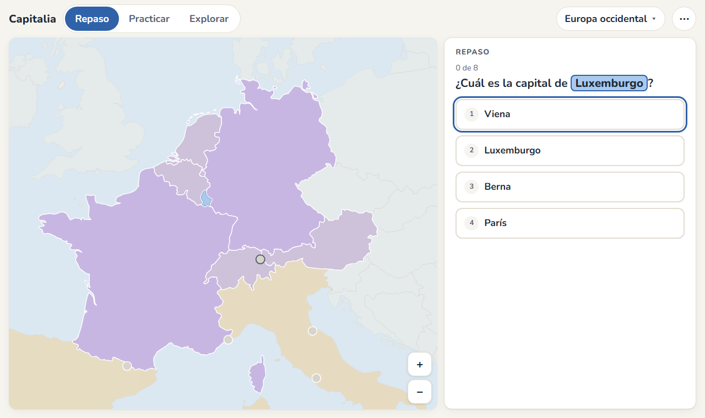
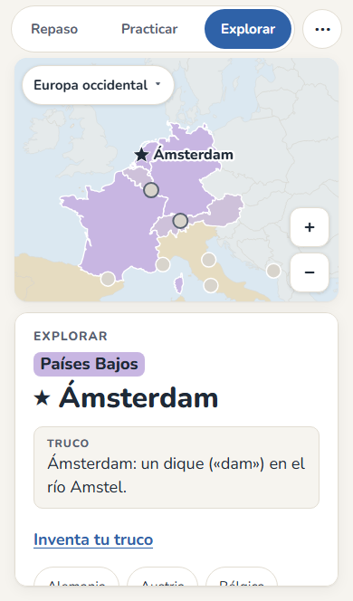
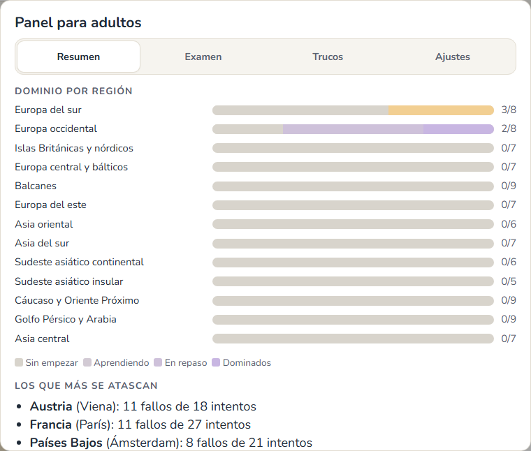

# Capitalia

**Aprende las capitales sobre el mapa, unos minutos al día.**

### 👉 [Abrir Capitalia](https://darmin-ddr.github.io/capitalia/)

Funciona en el navegador del móvil, la tableta o el ordenador. Gratis, sin cuentas y sin anuncios.



## Qué es

Capitalia es una app para aprender las capitales de los países sobre un mapa político. Está pensada para estudiantes de secundaria (empezó con los listados de 3º de ESO) y sirve tanto para practicar un poco cada día como para preparar un examen.

En lugar de leer una lista una y otra vez, la app te hace **recordar** las capitales, y decide qué preguntarte cada día para que no se te olviden.

## Cómo te ayuda a aprender

- **Repaso diario automático.** La app calcula cuándo estás a punto de olvidar cada capital y te la pregunta justo entonces (repetición espaciada). Lo que te sabes sale cada vez menos; lo que te cuesta, más a menudo. Unos diez minutos al día bastan.
- **Cuatro tipos de pregunta, de más fácil a más difícil:** elegir la capital entre cuatro, colocar capitales en su país, encontrar el país de una capital y escribirla sin ayuda. Cada país sube de nivel cuando ya te lo sabes.
- **El mapa es tu marcador.** Cada país se colorea a medida que lo dominas, y las regiones se van abriendo de una en una.
- **Trucos de memoria.** Algunos países traen uno, y puedes inventar los tuyos (la app incluye una guía para fabricarlos).
- **Fallar no castiga.** Cuando fallas, ves la respuesta y el truco, y ese país vuelve a salir en unos minutos. No hay rachas ni puntos que perder.
- **Escribir sin agobios.** No hace falta poner tildes ni mayúsculas, y si se te escapa una letra te lo damos por bueno (pero vuelve a salir para afianzarlo).

<p align="center">
  
</p>

## Para familias y docentes

La app tiene un **panel para adultos** protegido con un PIN (botón ⋯, arriba a la derecha):

- **Resumen:** cómo va cada región, qué países se le atascan al alumno y cuántos días ha practicado.
- **Examen:** marca los países que entran (puedes marcar Europa o Asia enteras, o una región) y la fecha. El alumno verá "Preparar examen", que pregunta primero lo más flojo sin alterar su repaso normal.
- **Trucos:** revisa, cambia o desactiva los trucos de memoria que trae la app.
- **Ajustes:** desbloquear todas las regiones (si el curso va en otro orden), cambiar el PIN o reiniciar el progreso.

La primera vez que se abre, la app pregunta quién la está usando y ofrece una guía breve tanto al alumno como a los adultos.

<p align="center">
  
</p>

## Instalarla

Se puede usar directamente en el navegador, pero instalada se abre como una app y **funciona sin conexión**:

- **iPhone o iPad:** abre la página en Safari, toca Compartir (el cuadrado con la flecha) y luego "Añadir a pantalla de inicio".
- **Android:** abre la página en Chrome, menú ⋮ y "Instalar aplicación" (o "Añadir a pantalla de inicio").
- **Ordenador:** en Chrome o Edge, pulsa el icono de instalar que aparece en la barra de direcciones.

## Privacidad

Todo se guarda **solo en tu dispositivo**. No hay cuentas, no se envían datos a ningún servidor y no hay publicidad ni seguimiento.

Como el progreso vive en el dispositivo, conviene hacer de vez en cuando una **copia de seguridad** (botón ⋯ → Descargar copia). Con "Copiar código" puedes pasar el progreso a otro dispositivo.

## Qué incluye ahora

- **Europa** (46 países) y **Asia** (49), con los nombres de los listados de clase de 3º de ESO, repartidos en 13 regiones. Rusia y Turquía aparecen en los dos continentes.
- Kosovo, que no figura en esos listados, está disponible como país opcional desde el panel para adultos.
- La app está preparada para añadir más regiones del mundo más adelante.

## Créditos

Creada por Darmin-ddr, con la ayuda de Claude (Anthropic).

- Mapa: [Natural Earth](https://www.naturalearthdata.com/) (dominio público), vía el paquete world-atlas.
- Coordenadas de las capitales: [GeoNames](https://www.geonames.org/) (CC BY 4.0).
- Repaso espaciado: algoritmo FSRS, librería [ts-fsrs](https://github.com/open-spaced-repetition/ts-fsrs) (MIT).
- Tipografía: Nunito (SIL Open Font License). Dibujo del mapa: d3-geo y topojson-client (ISC).

---

## Para desarrolladores

App web estática (PWA) hecha con Vite y TypeScript, sin framework. Se publica en GitHub Pages con cada push mediante `.github/workflows/pages.yml`.

```bash
npm install
npm run dev      # servidor de desarrollo
npm test         # tests de la lógica y de los datos
npm run build    # compilación para publicar (carpeta dist/)
```

Documentación del proyecto:

- [`SPEC.md`](SPEC.md): especificación del producto (fuente de verdad).
- [`CLAUDE.md`](CLAUDE.md): normas de trabajo.
- [`docs/notas-tecnicas.md`](docs/notas-tecnicas.md): estructura del código, scripts y cómo probar.
- [`docs/informe-noche.md`](docs/informe-noche.md): historial de la v1.0, decisiones tomadas y pruebas manuales pendientes.
- [`docs/listas/`](docs/listas/): listados de clase con los países y capitales.
